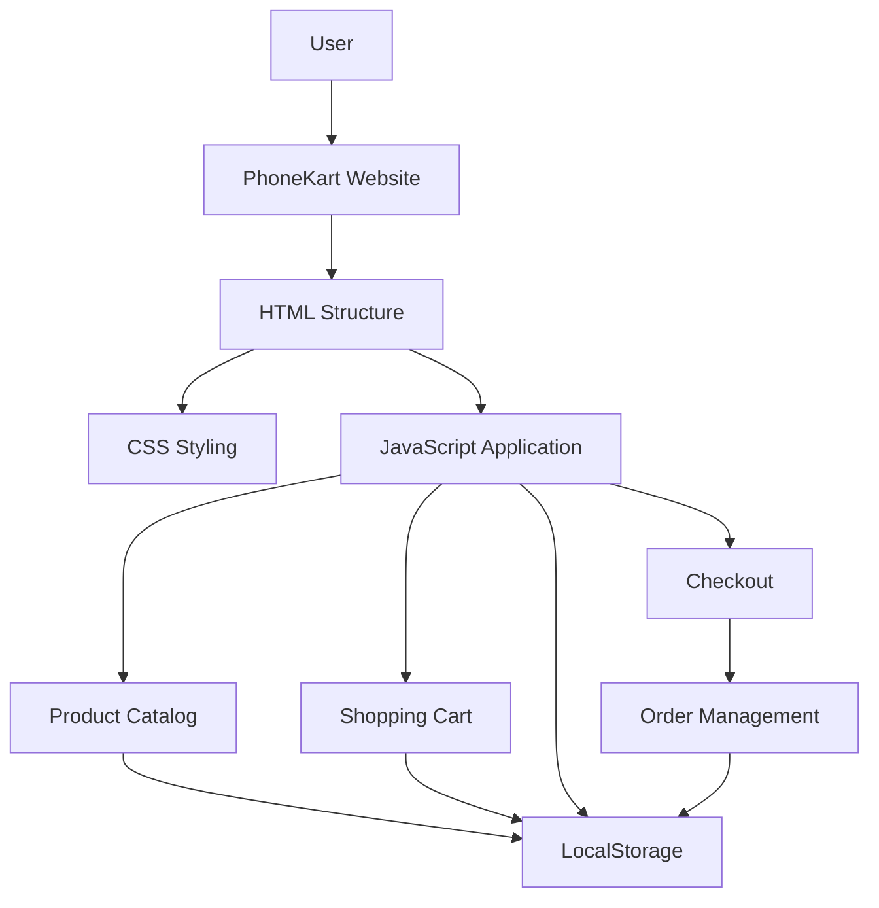

# PhoneKart – Premium Smartphone E-Commerce Website

PhoneKart is a modern, responsive mobile phone shopping website developed as a production capstone project. It provides an interactive shopping experience with a premium dark interface, product catalog, shopping cart, checkout simulation and order management.

## Project Overview

- Project Name: PhoneKart
- Project Type: E-Commerce Web Application
- Currency: Indian Rupees (INR)
- Design: Premium Dark UI
- Development: HTML5, CSS3 and JavaScript

## Features

### 1. Product Catalog
- Smartphone product listings.
- Multiple smartphone brands.
- Product images and prices.
- Brand-based category filtering.
- Product search functionality.
- Price sorting.

### 2. Shopping Cart
- Add products to cart.
- Increase and decrease quantities.
- Remove products.
- Automatic subtotal calculation.
- Dynamic cart item count.

### 3. User Authentication Simulation
- Registration interface.
- Login interface.
- Basic user session persistence.
- Sign-out functionality.

### 4. Checkout System
- Customer information form.
- Delivery address.
- Payment method selection.
- Simulated order placement.
- Order confirmation.

### 5. Order Management
- Order history.
- Unique order identification.
- Order totals and status.
- Persistent order information.

### 6. User Interface
- Premium dark theme.
- Animated gradient backgrounds.
- Interactive product cards.
- Hover effects and transitions.
- Responsive mobile and tablet layouts.
- Accessible form labels and keyboard focus styles.

## Technologies Used

| Technology | Purpose |
|---|---|
| HTML5 | Website structure |
| CSS3 | Styling and animations |
| JavaScript | Application functionality |
| LocalStorage | Browser-side persistence |
| Lucide Icons | Interface icons |
| Google Fonts | Typography |
| GitHub | Source code management |
| Vercel | Deployment |

## Project Structure

```text
PhoneKart/
│
├── index.html
├── README.md
│
├── css/
│   └── style.css
│
├── js/
│   └── script.js
│
└── assets/
    └── images/
```

## Application Architecture



## Setup Instructions

1. Clone or download the PhoneKart repository.
2. Open the project folder.
3. Open index.html in a web browser.
4. Browse the smartphone catalog.
5. Add products to the cart.
6. Test quantity changes and product removal.
7. Complete the simulated checkout.
8. View your order history.

The project can also be deployed using Vercel or Netlify.

## Data Persistence

PhoneKart uses browser LocalStorage to retain:
- Shopping cart information.
- Demo user information.
- Order history.

Data remains available after refreshing the same browser on the same device, provided its site storage is not cleared.

## Testing

The following functionality should be tested:

- Product display.
- Category filtering.
- Product search.
- Price sorting.
- Add-to-cart functionality.
- Quantity modification.
- Cart removal.
- Cart persistence.
- Registration and login simulation.
- Checkout form validation.
- Order confirmation.
- Order history.
- Responsive layouts.

## Important Limitations

This is a frontend demonstration project.

- Authentication is simulated and is not secure production authentication.
- Payments are simulated and no actual transactions are processed.
- LocalStorage is browser-specific and is not a server database.
- Product inventory and pricing are demonstration data.
- A production store would require a secure backend, database, payment gateway and authentication system.

## Future Enhancements

- Backend API integration.
- Secure authentication.
- Real payment gateway integration.
- Admin product management.
- Live inventory management.
- Product reviews and ratings.
- Order tracking.

## Deployment

Deployment Platform: Vercel

GitHub Repository: Add repository URL here.

Live Website: Add deployed URL here.

## Author

Developed as a Web Development Production Capstone Project.

**PhoneKart – Upgrade Your World.**
